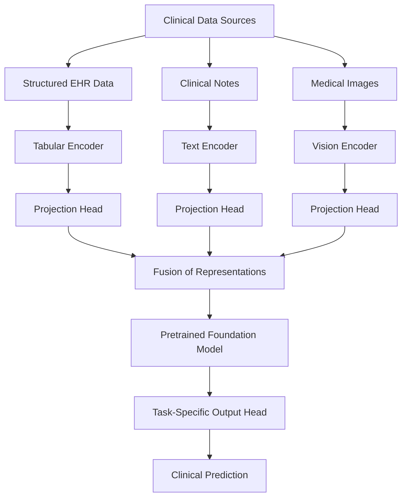

# Late Fusion

Late fusion is a multimodal learning approach in which separate models or encoders process different data modalities independently, and their predictions or learned representations are combined at a later stage.

In clinical research, for example, separate models may process structured EHR data (e.g., laboratory results and demographics), clinical notes, and medical images. Their outputs are then combined using a fusion method, such as averaging predicted probabilities, a weighted sum, or a trainable meta-model, to produce a final prediction.

Late fusion allows each modality to be processed with a model suited to its characteristics and can facilitate the integration of heterogeneous data sources. However, it may capture fewer cross-modal interactions than approaches that combine information earlier in the modeling pipeline.

### Multimodal Foundation Model Workflow

